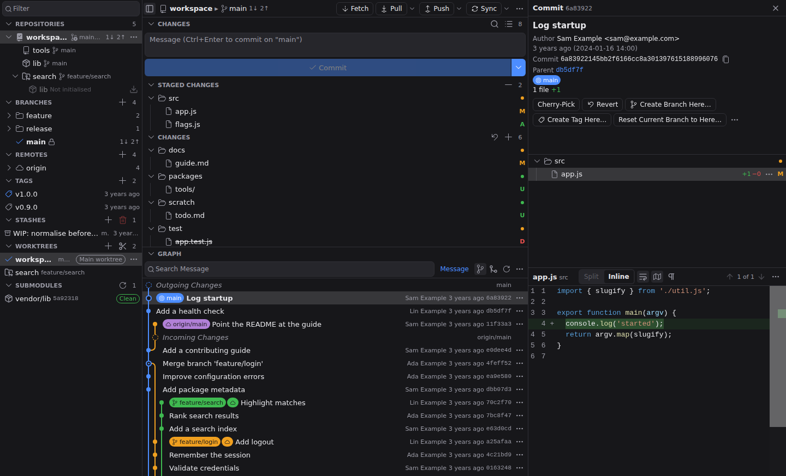
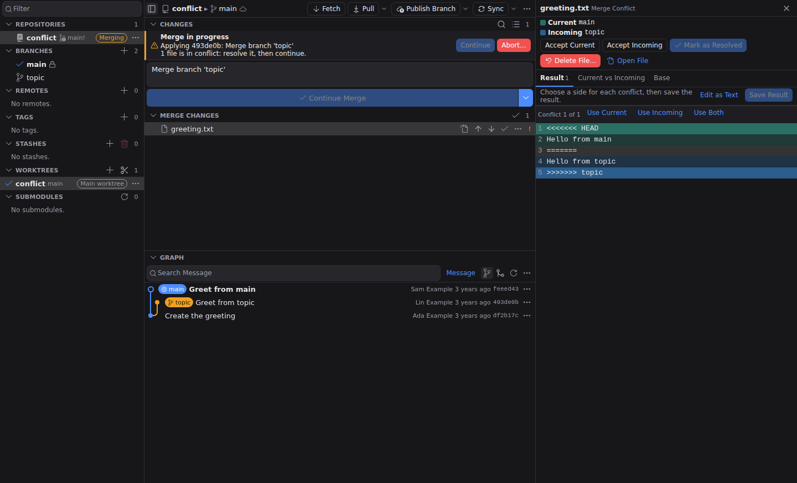
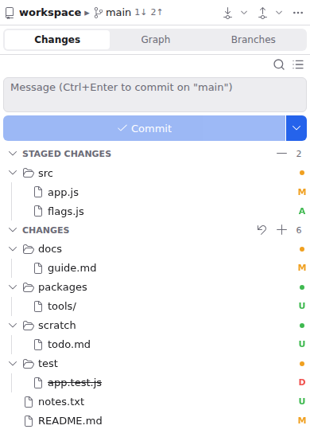
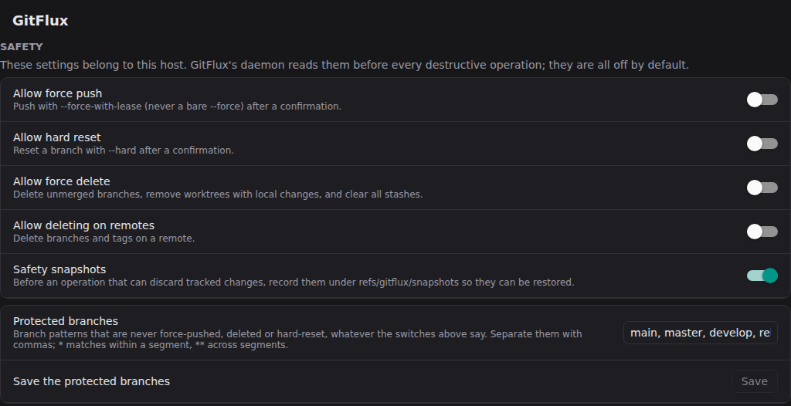

# Advanced Git for Paseo

**English** | [简体中文](README.zh-CN.md)

A full graphical Git client beside every [Paseo](https://paseo.sh) workspace, in the spirit of VS Code's Source
Control, GitLens, Git Graph and Fork. Every Git command runs through the system `git` on the host that owns the
workspace, local or remote.



## Features

- **Repositories**: nested repositories, submodules and worktrees, each with its branch and status.
- **Changes**: stage and unstage files, hunks or single lines; discard (untracked files go to the Trash); commit,
  amend, sign off, commit & push.
- **History**: commit graph across all branches or only the current one, with search, details, file history, blame
  and comparisons; cherry-pick, revert, reset and interactive rebase.
- **Branches & remotes**: create, switch, rename, delete, merge, rebase, track; fetch, pull, push, sync, publish;
  tags, stashes and worktrees.
- **Diffs & conflicts**: side-by-side or inline diffs with syntax colours; a conflict view to take a side per block,
  edit the result, and continue or abort the merge, rebase or cherry-pick.
- **Safe by default**: force push, hard reset and deletions are off until allowed per host, and always confirmed.
- **Everywhere**: resizable three-column layout that folds to tabs on a phone; light and dark themes; English and
  Simplified Chinese, following Paseo's language.

| Diff | Conflict | Phone |
| --- | --- | --- |
|  |  |  |

More in [docs/features.md](docs/features.md).

## Install

Requires Paseo 0.14.0+, and on each host: `git` 2.35+ and `npm` on the daemon's `PATH`.

```bash
paseo plugin install git:jjayjackie/paseo-advanced-git-plugin --ref v0.2.0
```

Or paste `git:jjayjackie/paseo-advanced-git-plugin` into **Settings → Plugins → Plugin source**. For a host without
network access, download `paseo-advanced-git-<version>-bundled.tgz` from
[Releases](https://github.com/jjayjackie/paseo-advanced-git-plugin/releases), check it with `SHA256SUMS`, extract it
and install the folder:

```bash
tar -xzf paseo-advanced-git-0.2.0-bundled.tgz
paseo plugin install "$(pwd)/paseo-advanced-git-0.2.0"
```

Open a workspace: **Advanced Git** appears as a tab and in the Explorer, with commands in the Command Center.

## Safety



- Force push (always `--force-with-lease`, never a bare `--force`), hard reset, force delete and deleting on a remote
  are **off by default**, checked on the host, and confirmed with what will be lost.
- Protected branches (`main`, `master`, `develop`, `release/*` by default) are never force-pushed, hard-reset or
  deleted.
- Changes about to be discarded are saved as safety snapshots under `refs/advanced-git/snapshots/`.
- The plugin never asks for, stores or sends a password or token: Git uses the host's SSH keys or credential helper.

## Known limitations

- Git runs without a terminal: configure an SSH agent or credential helper, as password prompts cannot be answered.
- Settings are per host (Paseo 0.14 has no per-device settings).
- Keyboard shortcuts and "Open file" are available on desktop and in a browser, not on iOS or Android.
- Interactive rebase offers pick, reword, edit, squash, fixup and drop; not `exec`, `break` or `--rebase-merges`.
- Not verified in CI: real forges with real credentials, remote hosts over a real network, native iOS/Android
  rendering, and macOS. Details in [docs/design.md](docs/design.md) and [docs/development.md](docs/development.md).

## Development

Nothing is built or tested locally: type checking, lint, unit, integration and browser tests, loading into real Paseo
daemons and packaging all run on GitHub Actions. See [docs/development.md](docs/development.md) and
[docs/architecture.md](docs/architecture.md).

## Credits

- Based on [Source Control for Paseo](https://github.com/KosmoCHE/paseo-source-control) by Kosmo CHE (MIT).
- Parts of repository discovery, the diff layout, conflict-marker parsing and colours are adapted from
  [VS Code](https://github.com/microsoft/vscode) 1.142.0, © Microsoft Corporation (MIT); each file names what it took.
- Icons: VS Code's [codicons](https://github.com/microsoft/vscode-codicons), © Microsoft Corporation,
  [CC BY 4.0](https://creativecommons.org/licenses/by/4.0/) (`client/ui/codicons.ts`, not covered by the MIT License),
  and [Lucide](https://lucide.dev) icons provided by Paseo.
- Design references: VS Code Source Control, [GitLens](https://github.com/gitkraken/vscode-gitlens),
  [Git Graph](https://github.com/mhutchie/vscode-git-graph) and [Fork](https://git-fork.com).
- Runtime dependencies: [vscode-diff](https://www.npmjs.com/package/vscode-diff),
  [strip-json-comments](https://www.npmjs.com/package/strip-json-comments) and [Prism](https://prismjs.com), all MIT.

## License

[MIT](LICENSE), except the codicons in `client/ui/codicons.ts` (CC BY 4.0).
