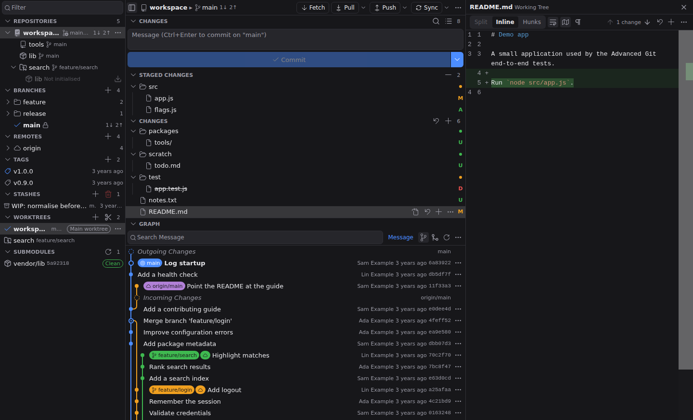

<div align="center">


# GitFlux

**A full graphical Git client inside every [Paseo](https://paseo.sh) workspace.**

Stage single lines, read the commit graph, rebase interactively and resolve conflicts,<br>
on any host Paseo reaches, from a desktop to a phone.

[](https://github.com/jjayjackie/GitFlux/actions/workflows/ci.yml)
[](https://github.com/jjayjackie/GitFlux/releases)
[](https://paseo.sh)
[](LICENSE)

**English** · [简体中文](README.zh-CN.md)

[Features](#features) · [Tour](#a-quick-tour) · [Install](#install) · [Safety](#safe-by-default) · [Docs](#documentation)

</div>

<br>


## Features

GitFlux runs the system `git` on the host that owns the workspace, local or remote, and draws everything around it in
a three-column panel. It follows VS Code's Source Control wherever VS Code has an answer, and GitLens, Git Graph and Fork
where it does not.

<table>
  <tr>
    <td width="50%" valign="top">
      <h3>📁 Every repository</h3>
      Nested repositories, submodules and linked worktrees in one navigator, each with its branch, ahead / behind
      counts and state. Branches, remotes, tags, stashes, worktrees and submodules sit beside them.
    </td>
    <td width="50%" valign="top">
      <h3>✏️ Precise staging</h3>
      Stage, unstage or discard a file, a folder, a hunk or a single line. Commit, amend, sign off, commit &amp; push
      or commit &amp; sync, with a draft kept per repository.
    </td>
  </tr>
  <tr>
    <td valign="top">
      <h3>🌳 A commit graph that acts</h3>
      All branches or only the current one, incoming and outgoing changes, search by message, author, hash, path or
      content. Cherry-pick, revert, reset, compare, and full menus on every branch and tag badge.
    </td>
    <td valign="top">
      <h3>🔀 Rewrite history calmly</h3>
      Interactive rebase with pick, reword, edit, squash, fixup, drop and reordering, checked as you go. Merge, rebase
      and cherry-pick banners offer Continue, Skip and Abort.
    </td>
  </tr>
  <tr>
    <td valign="top">
      <h3>🧩 Diffs and conflicts</h3>
      VS Code's diff algorithm and layout, side by side or inline, with syntax colours for some 40 languages. Resolve
      conflicts block by block, take a side, or edit the result.
    </td>
    <td valign="top">
      <h3>🛡️ Safe by default</h3>
      Force push, hard reset and deletions stay off until a host allows them, always ask first, and never touch a
      protected branch. Changes about to be discarded are snapshotted.
    </td>
  </tr>
  <tr>
    <td valign="top">
      <h3>📱 Desktop to phone</h3>
      A resizable three-column layout that folds into tabs on a narrow screen. Light and dark themes follow Paseo.
    </td>
    <td valign="top">
      <h3>🌐 English and 简体中文</h3>
      The interface follows Paseo's language. Git's own output, commit messages, names and paths are never
      translated.
    </td>
  </tr>
</table>

Every feature, pane by pane: [docs/features.md](docs/features.md).

## A quick tour

### Diffs

Side by side or inline, changed words marked, unchanged regions folded, whitespace shown or ignored. In **Hunks** mode
you stage, unstage or discard single hunks or selected lines.



### Conflicts

The current and incoming sides under git's own labels, the common base and the result. Choose a side per block, edit
the text, and mark the file resolved when no markers are left.


### Anywhere you use Paseo

<table>
  <tr>
    <td width="30%" align="center" valign="top">
      <br>
      <sub>Phone width: one pane at a time, under tabs</sub>
    </td>
    <td width="70%" align="center" valign="top">
      <br>
      <sub>Simplified Chinese, light theme</sub>
    </td>
  </tr>
</table>

### Keyboard

| Key | Action |
| --- | --- |
| <kbd>Ctrl</kbd> / <kbd>⌘</kbd> + <kbd>Enter</kbd> | Commit |
| <kbd>Alt</kbd> + <kbd>B</kbd> | Switch branch |
| <kbd>Alt</kbd> + <kbd>E</kbd> | Show or hide the navigator |
| <kbd>F7</kbd> / <kbd>Shift</kbd> + <kbd>F7</kbd> | Next / previous change in a diff |
| <kbd>?</kbd> | Every shortcut |

Shortcuts work in the desktop app and in a browser. Every action is also a button and a context-menu entry
(right-click, or a long press on a phone); the common ones are in the Command Center too.

## Install

**Requirements:** Paseo 0.14.0 or later. On each host that runs the plugin: `git` 2.35 or later and `npm` on the
daemon's `PATH`.

**From Git** (recommended):

```bash
paseo plugin install git:jjayjackie/GitFlux
```

You can also paste `git:jjayjackie/GitFlux` into **Settings → Plugins → Plugin source**. To pin a release, add
`--ref v<version>` with a tag from [Releases](https://github.com/jjayjackie/GitFlux/releases).

**Offline hosts:** download `gitflux-<version>-bundled.tgz` and `SHA256SUMS` from
[Releases](https://github.com/jjayjackie/GitFlux/releases), then:

```bash
sha256sum --check --ignore-missing SHA256SUMS
tar -xzf gitflux-<version>-bundled.tgz
paseo plugin install "$(pwd)/gitflux-<version>"
```

Then open a workspace: **GitFlux** appears as a tab and in the Explorer, and its commands are in the Command Center.

> [!IMPORTANT]
> **Upgrading from Advanced Git (0.2.0 or earlier).** The plugin ID changed from `advanced-git` to `gitflux`, so
> Paseo sees GitFlux as a new plugin. Uninstall `advanced-git`, install GitFlux, then turn your safety settings on
> again. Snapshots taken before the rename stay in each repository under `refs/advanced-git/snapshots/` but are no
> longer listed.

## Safe by default


| Guard | What it means |
| --- | --- |
| **Off until allowed** | Force push, hard reset, force delete and deleting on a remote are refused by the host until its settings allow them. |
| **Always confirmed** | Each destructive action says what will be lost and asks first. A hard reset asks you to type the branch name. |
| **Force with lease** | Force push always uses `--force-with-lease`, never a bare `--force`. |
| **Protected branches** | `main`, `master`, `develop` and `release/*` (by default) are never force-pushed, hard-reset or deleted. |
| **Safety snapshots** | Tracked changes about to be discarded are recorded under `refs/gitflux/snapshots/` and restore with one press. |
| **No credentials** | GitFlux never asks for, stores or sends a password or token. Git uses the host's SSH keys or credential helper. |
| **Hooks run** | Git hooks always run; nothing is committed or pushed with `--no-verify`. |

<details>
<summary><strong>Known limitations</strong></summary>

<br>

- Git runs without a terminal and cannot answer a password or host-key prompt: set up an SSH agent or a credential
  helper on the host.
- Settings are per host (Paseo 0.14 has no per-device settings), so view preferences are shared by everyone on a host.
- Keyboard shortcuts and "Open file" work on desktop and in a browser, not in the iOS and Android apps.
- Interactive rebase offers pick, reword, edit, squash, fixup and drop; not `exec`, `break` or `--rebase-merges`.
- Not verified in CI: real forges with real credentials, remote hosts over a real network, native iOS / Android
  rendering, and macOS. See [docs/design.md](docs/design.md) and [docs/development.md](docs/development.md).

</details>

## Documentation

| Document | What's in it |
| --- | --- |
| [Features](docs/features.md) · [功能详解](docs/features.zh-CN.md) | Everything the panel does, pane by pane |
| [Design](docs/design.md) | Where GitFlux follows VS Code, where it departs, and why |
| [Architecture](docs/architecture.md) | The contract: identity, layout, RPCs, safety rules, limits |
| [Development](docs/development.md) | How CI checks every change, and how to add a feature |

## Contributing

Nothing is built or tested locally. Type checking, lint, unit, integration and browser tests, loading into real Paseo
daemons and packaging all run on GitHub Actions: push a branch, open a pull request and read the checks. Start with
[docs/development.md](docs/development.md) and the rules in [docs/architecture.md](docs/architecture.md) §1.

## Credits

- Based on [Source Control for Paseo](https://github.com/KosmoCHE/paseo-source-control) by Kosmo CHE (MIT).
- Parts of repository discovery, the diff layout, conflict-marker parsing and colours are adapted from
  [VS Code](https://github.com/microsoft/vscode) 1.142.0, © Microsoft Corporation (MIT); each file names what it took.
- Icons: VS Code's [codicons](https://github.com/microsoft/vscode-codicons), © Microsoft Corporation,
  [CC BY 4.0](https://creativecommons.org/licenses/by/4.0/) (`client/ui/codicons.ts`, not covered by the MIT License),
  and [Lucide](https://lucide.dev) icons provided by Paseo.
- Design references: VS Code Source Control, [GitLens](https://github.com/gitkraken/vscode-gitlens),
  [Git Graph](https://github.com/mhutchie/vscode-git-graph) and [Fork](https://git-fork.com).
- Runtime dependencies: [vscode-diff](https://www.npmjs.com/package/vscode-diff),
  [strip-json-comments](https://www.npmjs.com/package/strip-json-comments) and [Prism](https://prismjs.com), all MIT.

## License

[MIT](LICENSE), except the codicons in `client/ui/codicons.ts` (CC BY 4.0).
