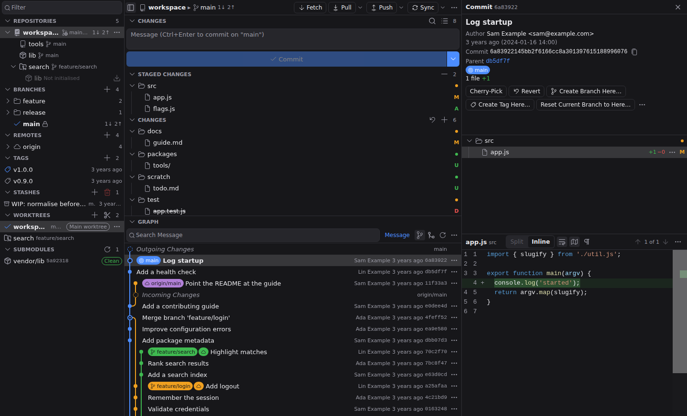
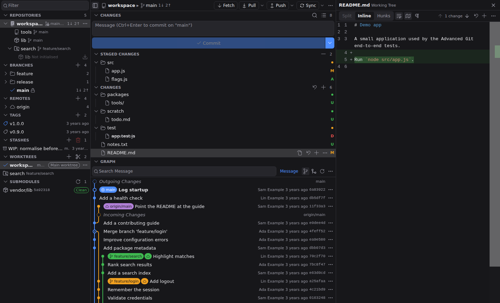
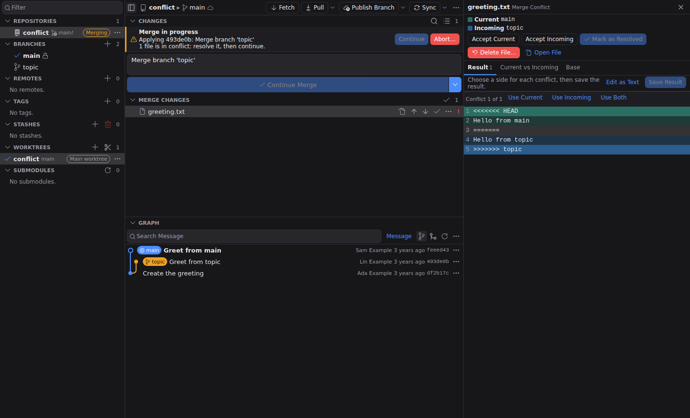
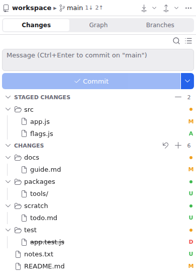
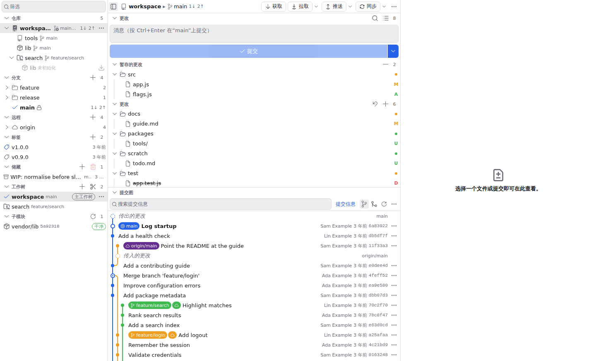
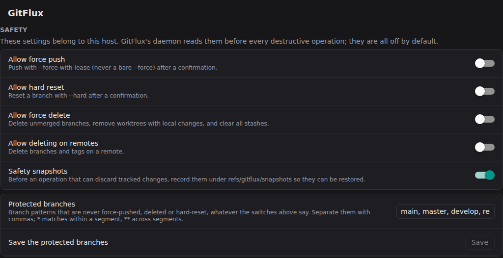

# Paseo 高级 Git

[English](README.md) | **简体中文**

在每个 [Paseo](https://paseo.sh) 工作区旁提供完整的图形化 Git 客户端，设计参考 VS Code 源代码管理、GitLens、Git Graph 和 Fork。所有 Git 命令都通过系统 `git` 在工作区所属的主机上执行，无论该主机是本地还是远程。



## 功能

- **仓库**：嵌套仓库、子模块和工作树，各自显示分支与状态。
- **更改**：按文件、代码块或单行暂存与取消暂存；放弃更改（未跟踪文件移到废纸篓）；提交、修补、签收、提交并推送。
- **历史**：可显示所有分支或仅当前分支的提交图，支持搜索、提交详情、文件历史、追溯（blame）和比较；拣选、还原、重置和交互式变基。
- **分支与远程**：创建、切换、重命名、删除、合并、变基、跟踪上游；获取、拉取、推送、同步、发布；标签、储藏和工作树。
- **差异与冲突**：带语法着色的并排或内联差异；冲突视图可逐块选择采用哪一方、编辑结果，然后继续或中止合并、变基或拣选。
- **默认安全**：强制推送、硬重置和删除操作在主机上明确允许之前一律禁止，执行前始终需要确认。
- **随处可用**：三栏布局可拖动调整，在手机上折叠为标签页；支持浅色与深色主题；支持英文和简体中文，跟随 Paseo 的语言设置。

| 差异 | 冲突 | 手机 |
| --- | --- | --- |
|  |  |  |



更多说明见 [docs/features.zh-CN.md](docs/features.zh-CN.md)。

## 安装

需要 Paseo 0.14.0 或更高版本；每台主机上的守护进程 `PATH` 中需要有 `git` 2.35+ 和 `npm`。

```bash
paseo plugin install git:jjayjackie/paseo-advanced-git-plugin --ref v0.2.0
```

也可以在 **设置 → 插件 → 插件来源** 中粘贴 `git:jjayjackie/paseo-advanced-git-plugin`。对于无法联网的主机，请从 [Releases](https://github.com/jjayjackie/paseo-advanced-git-plugin/releases) 下载 `paseo-advanced-git-<版本>-bundled.tgz`，用 `SHA256SUMS` 校验后解压并安装该目录：

```bash
tar -xzf paseo-advanced-git-0.2.0-bundled.tgz
paseo plugin install "$(pwd)/paseo-advanced-git-0.2.0"
```

打开一个工作区：**高级 Git** 会作为标签页出现，也会出现在资源管理器中，命令中心里也有它的命令。

## 安全



- 强制推送（始终使用 `--force-with-lease`，从不使用单独的 `--force`）、硬重置、强制删除和删除远程上的内容**默认关闭**，由主机端检查，执行前会列出将丢失的内容并要求确认。
- 受保护的分支（默认 `main`、`master`、`develop`、`release/*`）永远不会被强制推送、硬重置或删除。
- 即将被放弃的更改会先保存为安全快照，位于 `refs/advanced-git/snapshots/`。
- 插件从不索取、保存或发送密码和令牌：Git 使用主机上的 SSH 密钥或凭据助手。

## 已知限制

- Git 在没有终端的情况下运行，无法回答密码提示：请配置 SSH 代理或凭据助手。
- 设置按主机保存（Paseo 0.14 没有按设备保存的设置）。
- 键盘快捷键和“打开文件”仅在桌面应用和浏览器中可用，iOS 和 Android 上不可用。
- 交互式变基支持 pick、reword、edit、squash、fixup 和 drop，不支持 `exec`、`break` 和 `--rebase-merges`。
- 未在 CI 中验证：使用真实凭据访问真实代码托管平台、通过真实网络连接的远程主机、iOS/Android 原生渲染，以及 macOS。详见 [docs/design.md](docs/design.md) 和 [docs/development.md](docs/development.md)。

## 开发

本地不进行任何构建或测试：类型检查、lint、单元测试、集成测试、浏览器测试、加载到真实 Paseo 守护进程以及打包，全部在 GitHub Actions 上运行。详见 [docs/development.md](docs/development.md) 和 [docs/architecture.md](docs/architecture.md)。

## 致谢

- 基于 Kosmo CHE 的 [Source Control for Paseo](https://github.com/KosmoCHE/paseo-source-control)（MIT）。
- 仓库发现、差异布局、冲突标记解析和配色的部分代码改编自 [VS Code](https://github.com/microsoft/vscode) 1.142.0，© Microsoft Corporation（MIT）；每个文件都注明了所借鉴的内容。
- 图标：VS Code 的 [codicons](https://github.com/microsoft/vscode-codicons)，© Microsoft Corporation，[CC BY 4.0](https://creativecommons.org/licenses/by/4.0/)（位于 `client/ui/codicons.ts`，不适用 MIT 许可证），以及由 Paseo 提供的 [Lucide](https://lucide.dev) 图标。
- 设计参考：VS Code 源代码管理、[GitLens](https://github.com/gitkraken/vscode-gitlens)、[Git Graph](https://github.com/mhutchie/vscode-git-graph) 和 [Fork](https://git-fork.com)。
- 运行时依赖：[vscode-diff](https://www.npmjs.com/package/vscode-diff)、[strip-json-comments](https://www.npmjs.com/package/strip-json-comments) 和 [Prism](https://prismjs.com)，均为 MIT 许可证。

## 许可证

[MIT](LICENSE)，`client/ui/codicons.ts` 中的 codicons 除外（CC BY 4.0）。
